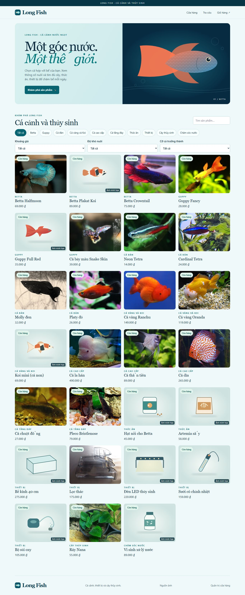
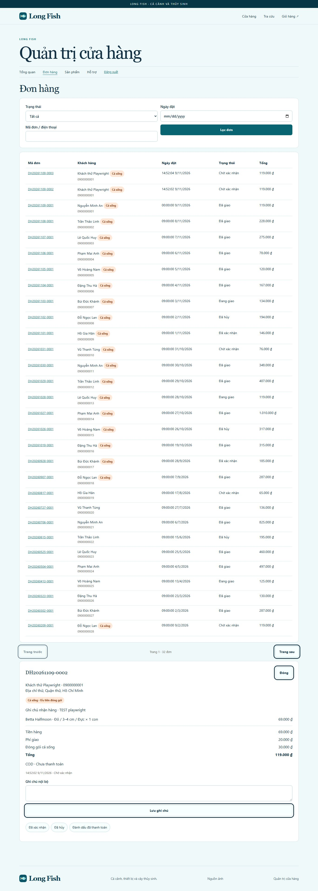

# Long Fish – Hệ thống bán cá cảnh qua Messenger, website và n8n

Đồ án tốt nghiệp về thương mại điện tử cho cửa hàng cá cảnh. Khách tư vấn qua Fanpage Messenger, chốt đơn trên website (COD hoặc chuyển khoản VietQR), tra cứu trạng thái; người bán xử lý đơn, in phiếu đóng gói và xem thống kê; n8n đồng bộ Google Sheets, gửi thông báo và tổng hợp doanh thu.





## Chạy nhanh

```bash
cp .env.example .env
docker compose up --build
```

Sau khi các dịch vụ khỏe:

- Website: http://localhost:8080
- Quản trị: http://localhost:8080/admin (tên `admin`; mật khẩu lấy bằng lệnh trong [docs/README.md](docs/README.md))
- n8n: http://localhost:5678

Mặc định `MOCK_INTEGRATIONS=true`: Messenger, Sheets và email được ghi ra log hoặc CSV thay vì gọi dịch vụ thật.

## Tài liệu

- [Hướng dẫn chi tiết và kiến trúc](docs/README.md)
- [Báo cáo đồ án](docs/bao-cao/00-muc-luc.md)
- [Báo cáo kiểm thử](docs/test-report.md)
- [Triển khai HTTPS](docs/DEPLOY.md) và [đưa lên hoạt động](docs/GO-LIVE.md)
- [Biến môi trường](docs/env-reference.md) và [API](docs/api-reference.md)
- [Sao lưu và khôi phục](docs/backup-restore.md)

## Kiểm thử

```bash
npm test                 # unit và HTTP test của backend
npm run test:ui          # Playwright (cần stack kiểm thử cách ly, xem docs/test-report.md)
npm run verify:all       # lint, build, test, audit, Playwright, kiểm tra tích hợp
```

`verify:all` báo FAIL ở bước tích hợp khi chưa cấu hình Facebook, Google, SMTP và ngân hàng. Đây là hành vi có chủ đích; xem [checklist bàn giao](docs/CHECKLIST-VIỆC-CỦA-TÔI.md).

## Giấy phép ảnh

Ảnh sản phẩm có nguồn và giấy phép được ghi trong trang "Nguồn ảnh" của website và trong `frontend/dist/catalog/photos/credits.json`.
