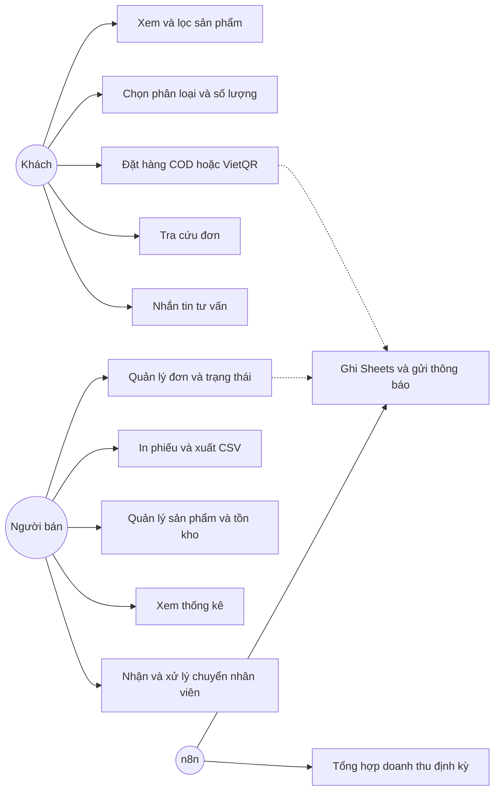
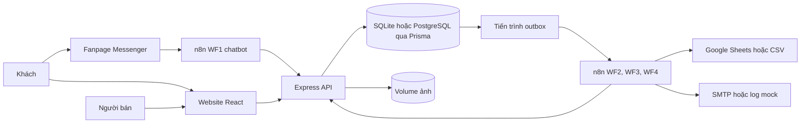
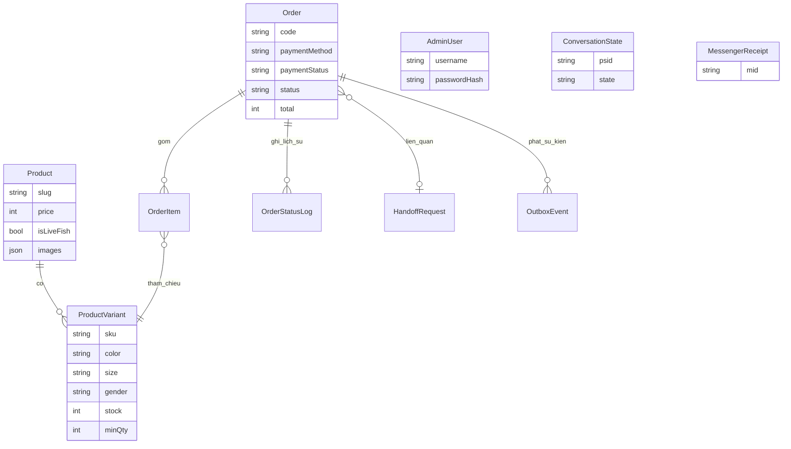
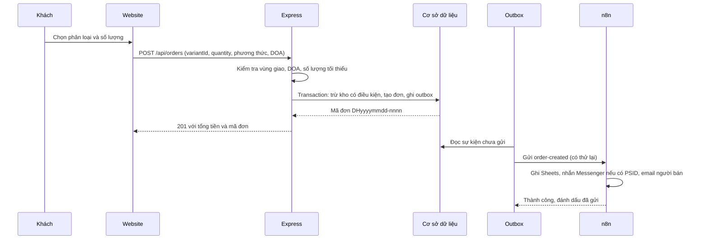
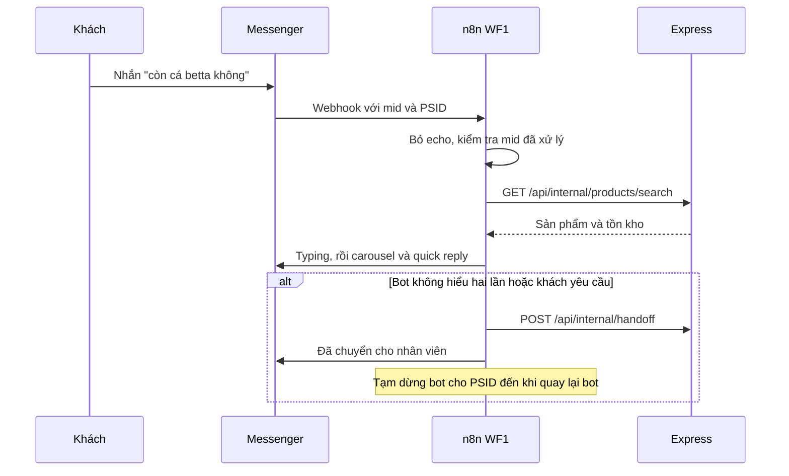

# 03. Phân tích và thiết kế

## 3.1 Yêu cầu chức năng

| Mã | Yêu cầu | Tác nhân |
|---|---|---|
| FR-01 | Xem danh mục, lọc theo nhóm, khoảng giá, độ khó nuôi; tìm có dấu và không dấu | Khách |
| FR-02 | Xem chi tiết cá: dòng, cỡ, giới tính, tồn kho từng phân loại, thông số nuôi tham khảo | Khách |
| FR-03 | Chọn phân loại và số lượng, không vượt tồn kho và không dưới số lượng tối thiểu | Khách |
| FR-04 | Checkout: thông tin nhận hàng, tự tính tiền hàng, phí giao, phí đóng gói, tổng | Khách |
| FR-05 | Thanh toán COD hoặc chuyển khoản VietQR với mã đơn trong nội dung | Khách |
| FR-06 | Tra cứu đơn bằng mã và số điện thoại, tự cập nhật mỗi 15 giây | Khách |
| FR-07 | Chatbot tư vấn, gợi ý, báo còn hàng, gửi liên kết đặt hàng, chuyển nhân viên | Khách, bot |
| FR-08 | Nhận đơn mới: ghi Sheets, nhắn xác nhận Messenger, email người bán | Hệ thống |
| FR-09 | Đổi trạng thái đơn theo luồng hợp lệ; hủy thì hoàn kho; ghi lịch sử | Người bán |
| FR-10 | Đối soát chuyển khoản qua webhook có khóa | Hệ thống ngân hàng |
| FR-11 | Thống kê doanh thu theo ngày và tháng; đếm đơn theo trạng thái; sản phẩm bán chạy | Người bán |
| FR-12 | Quản lý sản phẩm, phân loại, tồn kho, ảnh; cảnh báo tồn thấp | Người bán |
| FR-13 | In phiếu đóng gói A6; xuất CSV đơn và doanh thu | Người bán |
| FR-14 | Tổng hợp doanh thu định kỳ 23:55 hằng ngày và 00:10 đầu tháng | Hệ thống |
| FR-15 | Khách để lại email (không bắt buộc) nhận email xác nhận đơn và thông báo trạng thái | Khách, hệ thống |
| FR-16 | Trang sản phẩm hết hàng gợi ý mẫu cùng nhóm còn hàng | Khách |

## 3.2 Yêu cầu phi chức năng

- **Tính đúng đắn:** tiền tính bằng số nguyên VND; mọi giá và phí được tính lại trên máy chủ; tồn kho không âm và không bán vượt.
- **Độ tin cậy:** đơn không mất khi n8n ngừng; sự kiện được thử lại qua outbox.
- **Bảo mật:** xem mục 2.8; không đưa khóa, token, mật khẩu thật vào mã nguồn hoặc tài liệu.
- **Hiệu năng:** Lighthouse mobile trang chủ và trang sản phẩm đều từ 98 điểm trở lên trong lần đo cuối (xem chương 5).
- **Khả năng truy cập và di động:** giao diện đạt 100 điểm accessibility trong lần đo; kiểm thử không tràn ngang trên Pixel 7.
- **Khả năng triển khai:** chạy bằng Docker Compose; cấu hình HTTPS qua Caddy; sao lưu và khôi phục đã diễn tập.

## 3.3 Tác nhân và ca sử dụng

## 3.4 Kiến trúc tổng thể

Backend là trung tâm: mọi thay đổi về đơn, kho và giá đi qua API. n8n chỉ đọc qua các endpoint nội bộ có khóa, và nhận sự kiện qua outbox. Cách này giữ logic nghiệp vụ trong mã có kiểm thử thay vì nằm trong các nút n8n.

## 3.5 Mô hình dữ liệu

Các bảng chính trong `backend/prisma/schema.prisma`: `Product`, `ProductVariant`, `Order`, `OrderItem`, `OrderStatusLog`, `HandoffRequest`, `AdminUser`, `OrderSequence`, `OutboxEvent`, `ConversationState`, `MessengerReceipt`. Mã đơn lấy từ `OrderSequence` theo ngày, dạng `DH<năm><tháng><ngày>-<số thứ tự>`.

Enum trạng thái đơn: `PENDING`, `CONFIRMED`, `SHIPPING`, `DELIVERED`, `CANCELLED`. Luồng hợp lệ: `PENDING → CONFIRMED → SHIPPING → DELIVERED`; hủy được phép từ `PENDING` hoặc `CONFIRMED`, và từ `SHIPPING` khi người bán xác nhận rõ.

## 3.6 Sơ đồ tuần tự đặt hàng

Lỗi tồn kho trả về `409`, lỗi quy tắc cá sống trả về `422`. Khi n8n lỗi, đơn vẫn được tạo; sự kiện nằm trong outbox và được gửi lại.

## 3.7 Sơ đồ tuần tự chatbot

## 3.8 Thiết kế bot

Bot dùng luật có thứ tự ưu tiên: lệnh đặc biệt (quay lại bot, gặp nhân viên), tra cứu mã đơn, hỏi chăm sóc, hỏi vận chuyển và DOA, hỏi giá và ảnh, gợi ý theo nhu cầu, rồi chào hỏi. Từ điển đồng nghĩa xử lý dấu, viết tắt và sai chính tả nhẹ. Nếu không khớp, bot hỏi lại đúng một lần; lần thứ hai liên tiếp thì chuyển nhân viên. Bot không bao giờ tự nêu giá, tồn kho, khuyến mãi hay thời gian giao ngoài dữ liệu thật lấy từ API.
