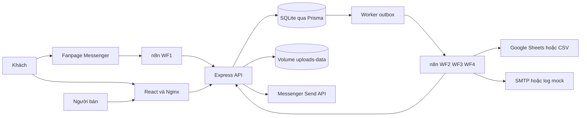
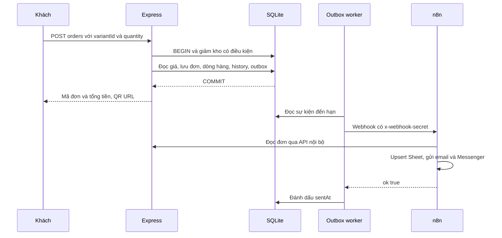
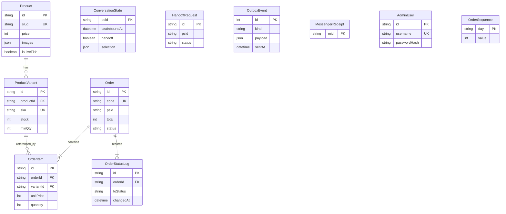

# Kiến trúc Long Fish

Frontend React/Vite phục vụ cửa hàng và admin. Express kiểm tra dữ liệu, xác thực, giữ kho và lưu đơn qua Prisma. SQLite là nguồn dữ liệu chính. Outbox trong cùng transaction với đơn lưu ý định gửi sự kiện, n8n thực hiện đồng bộ và thông báo. Website đọc ảnh local có giấy phép và ảnh upload trong volume.

PSID trong Order, HandoffRequest và ConversationState là khóa nghiệp vụ, hiện không khai báo foreign key giữa các bảng này. Outbox tham chiếu đơn bằng code trong payload. Tệp upload dùng UUID và được tham chiếu từ Product.images, chưa có bảng media riêng.

## Quyết định công nghệ

| Công nghệ | Lý do và giới hạn |
|---|---|
| Node.js 20, Express, TypeScript | Cùng ngôn ngữ với frontend, phù hợp webhook và JSON API. Cần quản lý vòng đời Node và phụ thuộc khi triển khai lâu dài. |
| Prisma, SQLite | Transaction và schema rõ, chạy demo đơn giản bằng một volume. SQLite có một writer, cần đánh giá PostgreSQL khi nhiều đơn đồng thời. |
| React, Router, Tailwind, Recharts | Một ứng dụng cho khách/admin, chọn phân loại và giá theo trạng thái, có biểu đồ. Chưa có kết quả Lighthouse đo mới. |
| n8n | Trình bày luồng tích hợp trực quan, credential dịch vụ nằm trong n8n. Workflow chỉ import tự động một lần, bản cập nhật cần import/publish. |
| Outbox | Đơn và ý định phát sự kiện commit cùng nhau, retry có backoff. Các bước thông báo có thể lặp nếu workflow lỗi sau khi đã gửi, chưa có exactly-once toàn hệ thống. |
| Sharp, WebP và volume ảnh | Xác minh ảnh và tạo thumbnail trên server. Cần backup volume cùng database. |

Giá VND dùng số nguyên. Doanh thu gồm tổng tiền đơn DELIVERED theo ngày đặt ở Asia/Ho_Chi_Minh. Doanh thu danh mục chỉ gồm tiền hàng, phần ship và đóng gói không phân bổ vào danh mục. Thống kê top cá chỉ lấy dòng hàng isLiveFish.

## Bảng API

Danh sách đầy đủ được trích từ route Express trong [api-reference.md](../api-reference.md). Public dùng rate limit, admin dùng Bearer JWT audience long-fish-admin, nội bộ dùng x-api-key. Nginx chặn truy cập /api/internal từ cổng public. /uploads chỉ phục vụ tên tệp UUID WebP hợp lệ.

Tài liệu chính xác về schema nằm ở `backend/prisma/schema.prisma`, transaction ở `backend/src/orders.ts`, worker ở `backend/src/outbox.ts`, workflow ở `n8n/workflows`.
